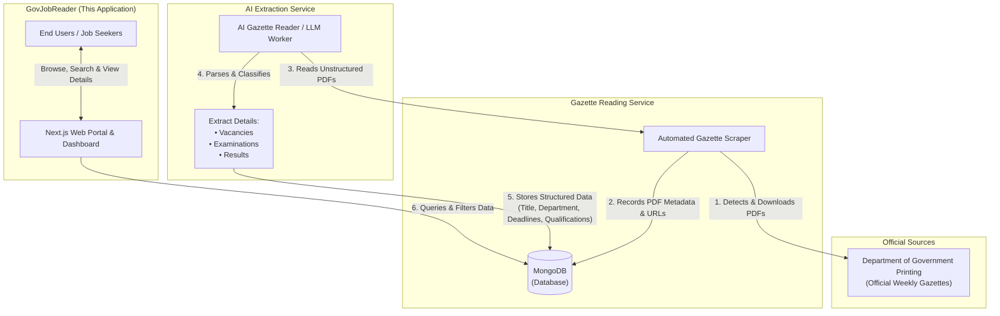

# 🏛️ Sri Lanka Gov Job Tracker (GovJobReader)

An automated platform and web dashboard that tracks, parses, and organizes Sri Lankan Government Gazette publications. It provides job seekers and applicants with structured, real-time insights into government vacancies, examinations, and results.

---

## 📌 System Architecture & Ecosystem

The platform operates as a decoupled architecture where backend processing services work independently alongside this Next.js web application:



### ⚙️ How the Autonomous Services Work

1. **Gazette Reading Service**:
   - Periodically monitors and downloads the latest official Government Gazette publications in PDF format.
   - Registers publication dates, source URLs, sections, and maintains the synchronization registry in MongoDB (`Gazette` and `SyncState` models).
2. **AI Extraction & Processing Service**:
   - Works individually in the background to analyze raw PDF documents using AI/LLM models.
   - Identifies and categorizes updates into three core types:
     - 💼 **Vacancies**: Job title, department/ministry, job descriptions, closing dates, and required qualifications.
     - 🎓 **Examinations**: Exam announcements, application procedures, eligibility criteria, and deadlines.
     - 📜 **Results**: Examination results, pass lists, and recruitment notices.
   - Populates MongoDB with clean, structured records (`ExtractedJob` model).
3. **GovJobReader Web Portal (This Repo)**:
   - Connects directly to the MongoDB database to display real-time updates.
   - Provides an intuitive interface for filtering, searching, reviewing qualifications, and accessing original Gazette PDFs.

---

## ✨ Features

- **📂 Categorized Views**: Seamless tab navigation across **All Updates**, **Vacancies**, **Examinations**, and **Results**.
- **🔍 Full-Text Search**: Instant search across titles, department names, descriptions, and qualifications.
- **📑 Detailed Job Modal**: View full descriptions, required qualifications/skills list, closing deadlines, and direct links to the official Gazette PDF.
- **⚙️ System Settings & Registry**:
  - **Synchronization History**: Audit scraping status, last attempt timestamps, and item count per gazette date.
  - **Processed PDF Registry**: Inspect tracked PDF files, language, and extraction metadata.
- **🌐 Reverse Proxy & Subpath Deployment**: Built-in support for running under a custom subpath (e.g., `/gov-jobs`) behind reverse proxies (Nginx, Traefik, Cloudflare).
- **🎨 Modern Dark UI**: Designed with Tailwind CSS v4, smooth Framer Motion animations, Lucide icons, and toast notifications.
- **🐳 Docker Ready**: Multi-stage Docker containerization ready for production deployments.

---

## 🛠️ Tech Stack

- **Framework**: [Next.js 16](https://nextjs.org) (App Router, Server Actions)
- **Library**: [React 19](https://react.dev)
- **Language**: [TypeScript](https://www.typescriptlang.org/)
- **Database**: [MongoDB](https://www.mongodb.com/) with [Mongoose](https://mongoosejs.com/)
- **Styling**: [Tailwind CSS v4](https://tailwindcss.com/)
- **Animations & Icons**: [Framer Motion](https://www.framer.com/motion/), [Lucide React](https://lucide.dev/)
- **Notifications**: [React Hot Toast](https://react-hot-toast.com/)
- **Containerization**: [Docker](https://www.docker.com/) (Node 20 Alpine)

---

## 📁 Repository Structure

```text
GovJobReader/
├── src/
│   ├── app/
│   │   ├── components/
│   │   │   └── Dashboard.tsx      # Main dashboard with search, tabs, pagination & detail modal
│   │   ├── settings/
│   │   │   └── page.tsx           # Scraper sync history & processed PDF registry
│   │   ├── actions.ts             # Server actions (fetchJobs, fetchSettingsData)
│   │   ├── globals.css            # Global CSS styles & Tailwind configuration
│   │   ├── layout.tsx             # Root layout with Geist font & toast provider
│   │   └── page.tsx               # Homepage view
│   ├── lib/
│   │   ├── db.ts                  # Cached MongoDB connection handler
│   │   └── paths.ts               # Subpath prefix & reverse proxy URL utility
│   └── models/
│       ├── ExtractedJob.ts        # Schema for extracted vacancies, exams, & results
│       ├── Gazette.ts             # Schema for scraped Gazette PDFs
│       └── SyncState.ts           # Schema for synchronization & scraping status
├── public/                        # Static assets & icons
├── .env.example                   # Example environment variable template
├── Dockerfile                     # Multi-stage production Docker build
├── next.config.ts                 # Next.js configuration
├── package.json                   # Project scripts and dependencies
└── tsconfig.json                  # TypeScript compiler settings
```

---

## 🚀 Getting Started

### Prerequisites

- **Node.js**: v20 or higher
- **npm** / **pnpm** / **yarn** / **bun**
- **MongoDB**: A running MongoDB instance (local or [MongoDB Atlas](https://www.mongodb.com/atlas))

### 1. Clone the Repository

```bash
git clone https://github.com/kbimsara/GovJobReader.git
cd GovJobReader
```

### 2. Configure Environment Variables

Create a `.env.local` file in the root directory based on `.env.example`:

```bash
cp .env.example .env.local
```

Configure your variables:

```env
# MongoDB Connection String
MONGODB_URI=mongodb+srv://<username>:<password>@cluster0.mongodb.net/govJobDB?retryWrites=true&w=majority

# Optional: Subpath Deployment Prefix (e.g., when behind a reverse proxy like /gov-jobs)
# NEXT_PUBLIC_BASE_PATH=/gov-jobs
```

### 3. Install Dependencies

```bash
npm install
```

### 4. Run Development Server

```bash
npm run dev
```

Open [http://localhost:3000](http://localhost:3000) in your browser to view the application.

---

## 📦 Production & Deployment

### Build and Run Locally

```bash
# Build production bundle
npm run build

# Start production server
npm start
```

### Run with Docker

Build and run using the optimized multi-stage `Dockerfile`:

```bash
# Build the Docker image
docker build -t gov-job-reader .

# Run the container
docker run -d \
  -p 3000:3000 \
  --name gov-job-reader \
  --env-file .env.local \
  gov-job-reader
```

### Subpath / Reverse Proxy Configuration

If serving the application under a subpath (e.g., `https://yourdomain.com/gov-jobs`), set:

```env
NEXT_PUBLIC_BASE_PATH=/gov-jobs
```

The application's internal link utilities (`paths.ts`) will automatically resolve navigation links and assets accordingly.

---

## 📊 Database Models

- **`ExtractedJob`**: Stores extracted items with fields such as `title`, `description`, `department`, `type` (`Vacancy` | `Examination` | `Result`), `closingDate`, `qualifications`, `sourcePdf`, `pageNumber`, and `gazetteDate`.
- **`Gazette`**: Tracks scraped Gazette PDFs with `date`, `name`, `pdfUrl`, `language`, `sectionTitle`, `status`, and `timestampScraped`.
- **`SyncState`**: Tracks synchronization progress per gazette date (`targetDate`, `isComplete`, `lastAttempt`).

---

## 📄 License

This project is licensed under the [MIT License](LICENSE).
